> 這支影片分四段：先逐層拆開 DINOv2 的架構，再講它怎麼訓練，接著看訓練結果，最後看 RF-DETR 怎麼用它。
> 除了標「示意」的畫面，每張圖都由真正的 DINOv2-S 算出，輸入就是這張貓咪照片。

## 1-1 輸入
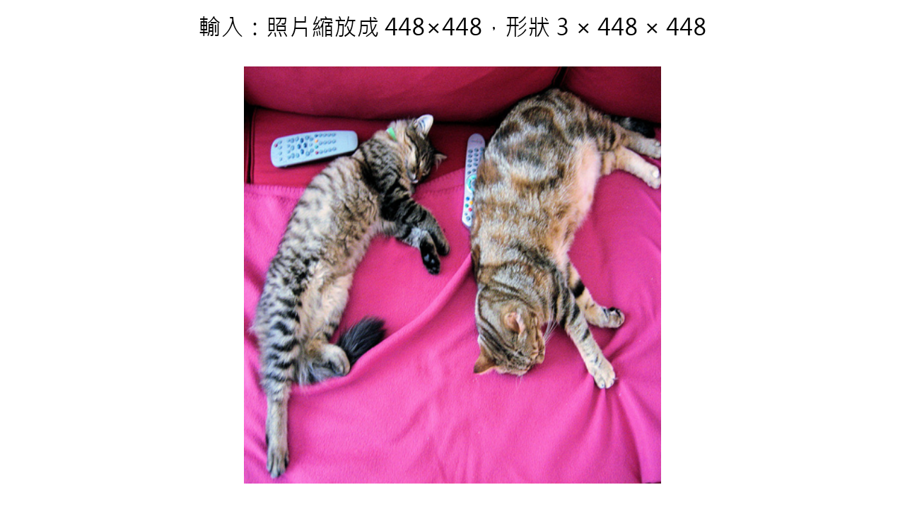
> 先看架構。輸入是一張照片，縮放成 448 乘 448。
> 它的形狀是 3 乘 448 乘 448，3 代表紅、綠、藍三個顏色。

## 1-2 Patch Embedding
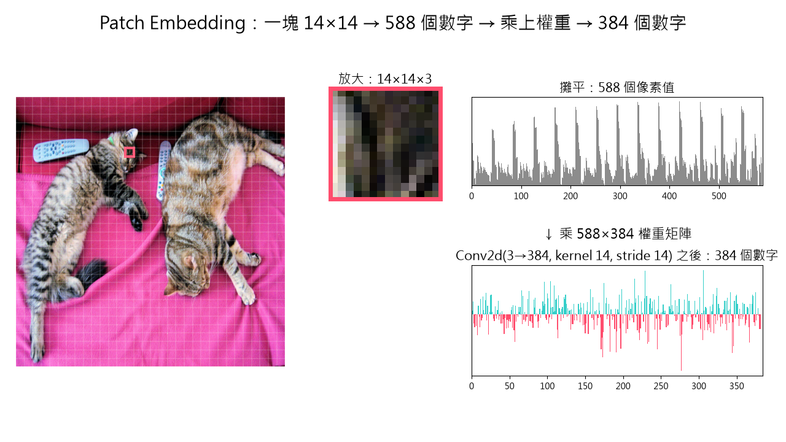
> 第一層叫 Patch Embedding。先看左貓頭上這一塊 14 乘 14 的方塊。
> 它有 14 乘 14 乘 3，一共 588 個像素值，就是右上這排灰色長條。
> 乘上一個 588 乘 384 的權重矩陣，就變成右下這 384 個數字。這就是這塊的 embedding。

## 1-3 全部 patch
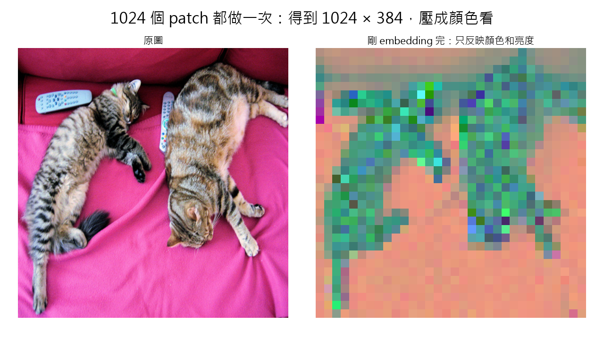
> 448 除以 14 是 32，所以一共 32 乘 32，1024 塊，每塊都做一次。
> 右邊是這 1024 個向量壓成顏色的樣子。現在它只反映顏色和亮度，還不懂什麼是貓。

## 1-4 CLS token
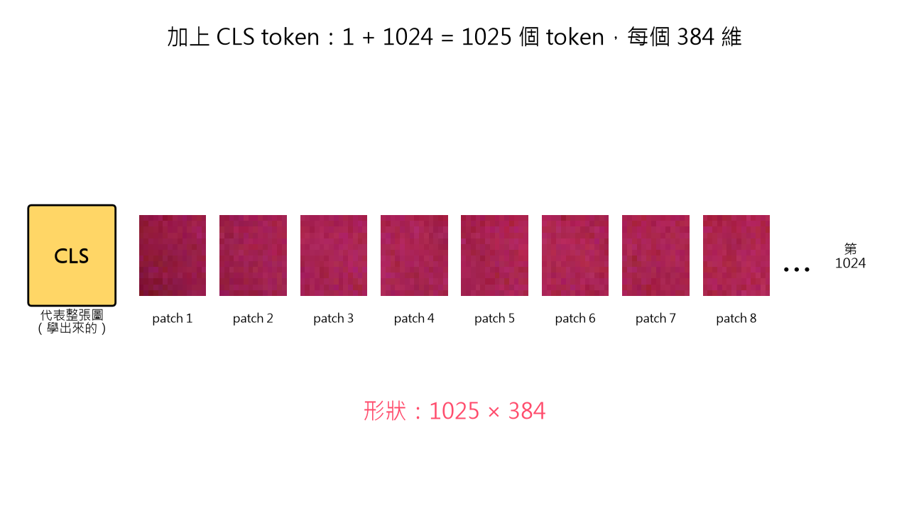
> 接著在最前面多放一個特別的 token，叫 CLS。它不對應任何一塊圖，數值是訓練學出來的。
> 它的任務是收集整張圖的資訊。現在一共 1025 個 token，每個 384 維。

## 1-5 位置 embedding
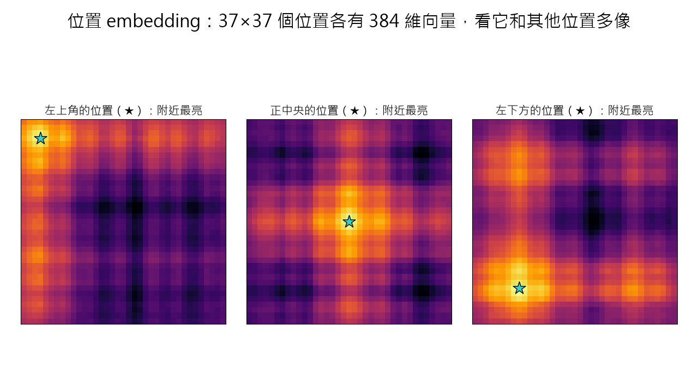
> 到這裡，模型還不知道每塊在哪裡。所以每個位置要再加上一組位置 embedding。
> 預訓練時有 37 乘 37 個位置。看這三張圖：每個位置的向量，都和自己附近的位置最像。
> 輸入解析度不同時，這張位置表會內插成需要的大小。

## 1-6 一個 Block 的結構
```flow
輸入 x -> LayerNorm 1
LayerNorm 1 -> *多頭自注意力
*多頭自注意力 -> LayerScale 1
LayerScale 1 -> 加回去 1
輸入 x --> 加回去 1: 殘差
加回去 1 -> LayerNorm 2
LayerNorm 2 -> *MLP
*MLP -> LayerScale 2
LayerScale 2 -> 加回去 2
加回去 1 --> 加回去 2: 殘差
加回去 2 -> 輸出
```
> 接下來是 12 個 Block。每個 Block 結構一樣，形狀進去是 1025 乘 384，出來也是。
> [LayerNorm 1] 先把每個 token 的 384 個數字標準化，數值不會忽大忽小。
> 接著是[多頭自注意力]，讓 token 之間互相交換資訊。
> [LayerScale 1] 把算出的改動乘上一組學出來的倍率。
> 然後把改動加回原本的輸入，這叫殘差連接。
> 這條虛線就是殘差：原本的資訊一定保留，Block 只負責「再加一點」。
> 第二段一樣，先做 [LayerNorm 2]。
> 接著是 [MLP]，每個 token 各自加工，不和別人交換。
> 再乘上 [LayerScale 2]。
> 一樣加回去。
> 第二條殘差也保留原本的資訊。
> 這就是一個 Block，DINOv2-S 疊了 12 個。

## 1-7 Q、K、V
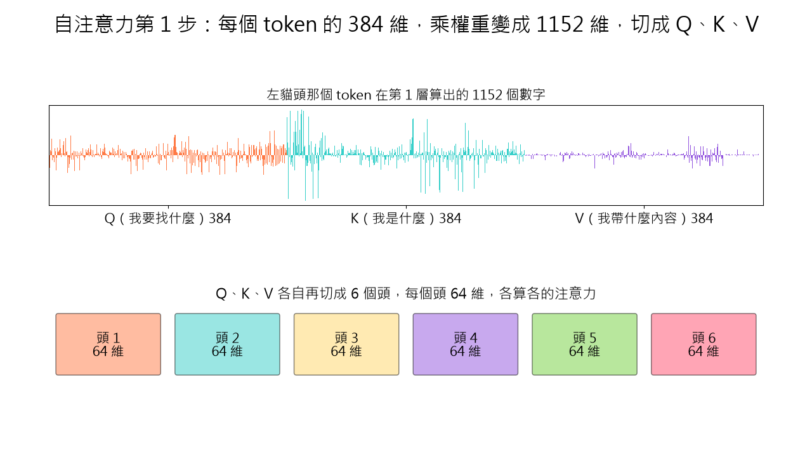
> 拆開自注意力。每個 token 的 384 個數字，乘上權重變成 1152 個，切成三段。
> Q 代表「我要找什麼」，K 代表「我是什麼」，V 代表「我帶什麼內容」。
> 每段再切成 6 個頭，每頭 64 維。6 個頭各自找不同的關係。

## 1-8 注意力怎麼算
```flow LR
我的 Q -> *和每個 K 比對
所有 token 的 K -> *和每個 K 比對
*和每個 K 比對 -> softmax 變成權重
softmax 變成權重 -> 加權平均所有 V
加權平均所有 V -> 我的新內容
```
> 注意力的算法是這樣。拿[我的 Q]。
> 去和[所有 token 的 K] 一一比對，也就是內積。
> 越像的，分數越高。
> 用 softmax 把 1025 個分數變成加起來等於 1 的權重。
> 再用這組權重，把所有 token 的 V 加權平均。
> 結果就是這個 token 的新內容。它吸收了「最相關的那些 token」的資訊。

## 1-9 第 1 層的 6 個頭
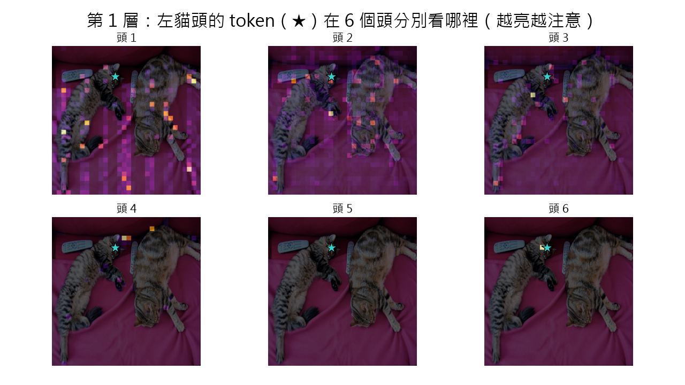
> 實際看第 1 層。星號是左貓頭的 token，越亮代表越注意。
> 頭 4、5、6 幾乎只看自己和旁邊幾格。頭 1、2 則散到整張圖的零星位置。
> 這時候還談不上「看懂」，只是在收集附近的線索。

## 1-10 MLP
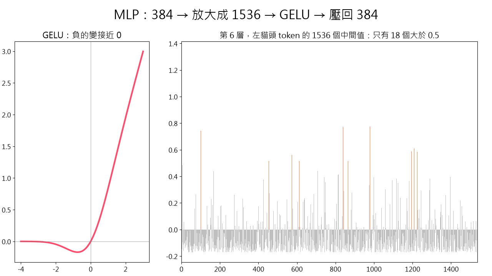
> 再拆 MLP。它先把 384 維放大成 1536 維，經過 GELU，再壓回 384 維。
> GELU 會把負的值壓到接近 0。看右邊，第 6 層左貓頭這個 token，1536 個中間值只有 18 個大於 0.5。
> 你可以想成 1536 個「特徵偵測器」，每個 token 只會觸發其中一小部分。

## 1-11 每層改了多少
```chart line
| 注意力的改動 | MLP 的改動
第1層 | 0.784 | 0.858
第2層 | 0.921 | 0.927
第3層 | 0.703 | 0.791
第4層 | 0.708 | 0.697
第5層 | 0.681 | 0.655
第6層 | 0.888 | 0.868
第7層 | 0.76 | 0.847
第8層 | 1.045 | 1.024
第9層 | 1.038 | 0.955
第10層 | 0.969 | 0.969
第11層 | 0.753 | 1.031
*第12層 | 2.694 | 0.622
```
> 每層加回去的改動有多大？我把改動向量的長度，除以原本向量的長度。
> 大部分層的比值在 0.6 到 1 之間，每層都改得不少。
> 第 12 層的注意力最特別，比值是 2.69，它最後一次大幅整合全圖資訊。

## 1-12 12 層逐層看
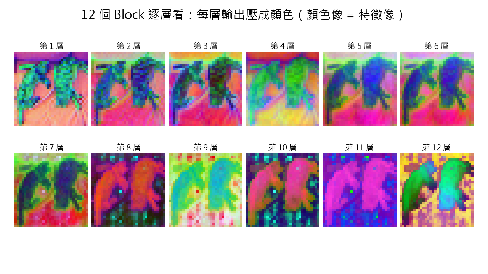
> 現在看 12 層各自輸出什麼。每張都是那一層的 1024 個向量壓成顏色。
> 第 1 到 3 層還看得到毛的紋理，很像原圖。
> 第 5 層起，貓和沙發明顯分成兩塊。到第 12 層，兩隻貓都變成綠色系，沙發是另一種顏色。

## 1-13 一個 token 的變化
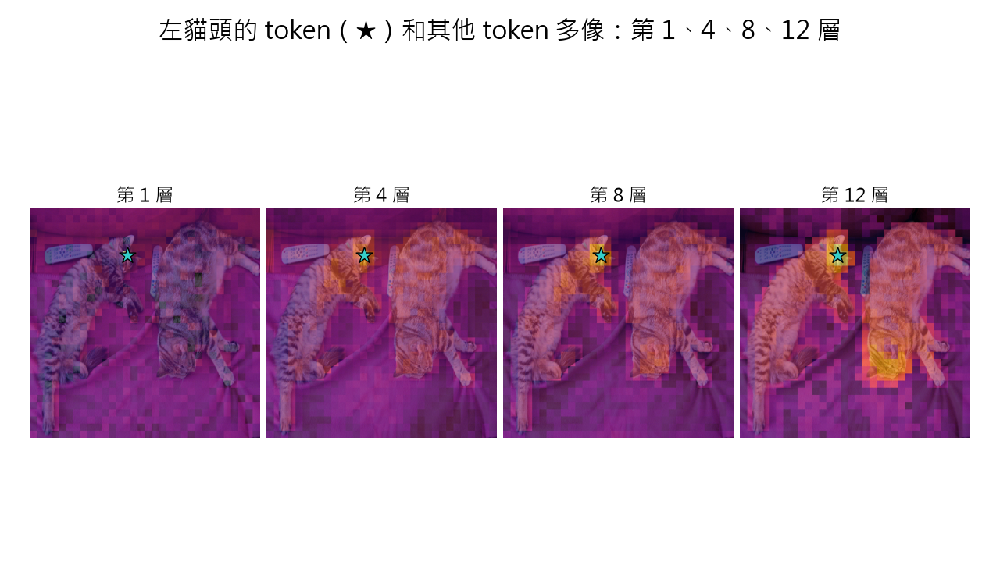
> 再盯著左貓頭這個 token，看它和誰像。
> 第 1 層，它只像自己。第 4 層和第 8 層，左邊那隻貓慢慢亮起來。
> 第 12 層，連右邊那隻貓的頭也亮了。它已經知道「這兩個都是貓頭」。

## 1-14 CLS 在看哪裡
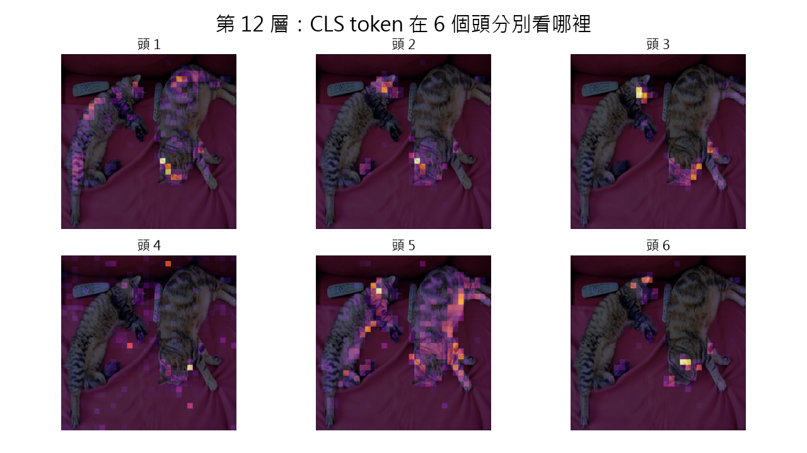
> 最前面那個 CLS token 呢？這是第 12 層，CLS 的 6 個頭各看哪裡。
> 亮點大多落在兩隻貓身上，有的頭看頭，有的頭看身體。
> 它沒被教過什麼是主角，但自己學會把注意力放在主角上。

## 1-15 最後的輸出
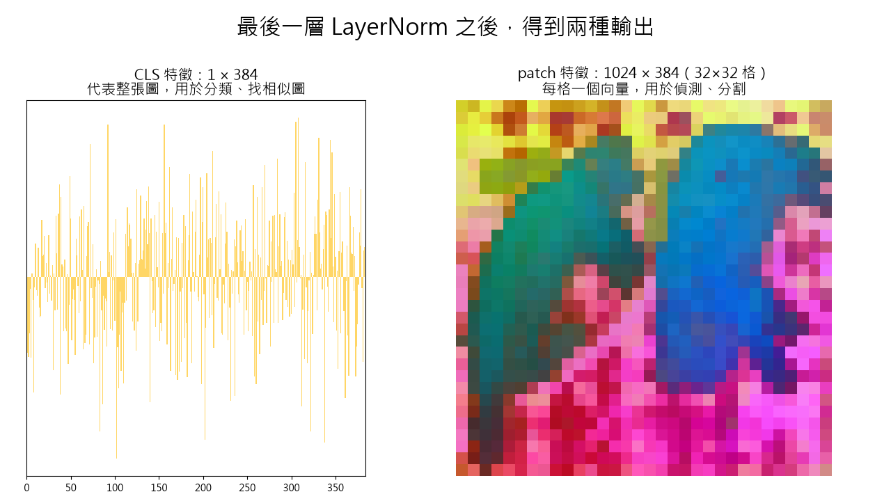
> 12 層跑完，再做一次 LayerNorm，就得到兩種輸出。
> 左邊是 CLS 特徵，384 個數字，代表整張圖，可以拿來分類或找相似圖。
> 右邊是 1024 個 patch 特徵，每格 384 維，可以拿來偵測和分割。RF-DETR 用的就是這種。

## 1-16 訓練時才有的頭（示意）
```flow LR
CLS 特徵 -> DINO head
DINO head -> 約 6.5 萬個編號的機率
被遮的 patch 特徵 -> iBOT head
iBOT head -> 每個 patch 的編號機率
```
> 訓練時，模型後面還接著兩個頭。公開的模型已經拿掉了，所以這裡是示意。
> [DINO head] 把 CLS 特徵變成約 6.5 萬個編號的機率，就是上一段講的「編號簿」。
> 老師學生的比對，就是比這組機率。
> [iBOT head] 則對被遮住的 patch 做同樣的事。
> 學生要猜出被遮住那一塊，老師會給它什麼編號。

## 2-1 沒有標籤
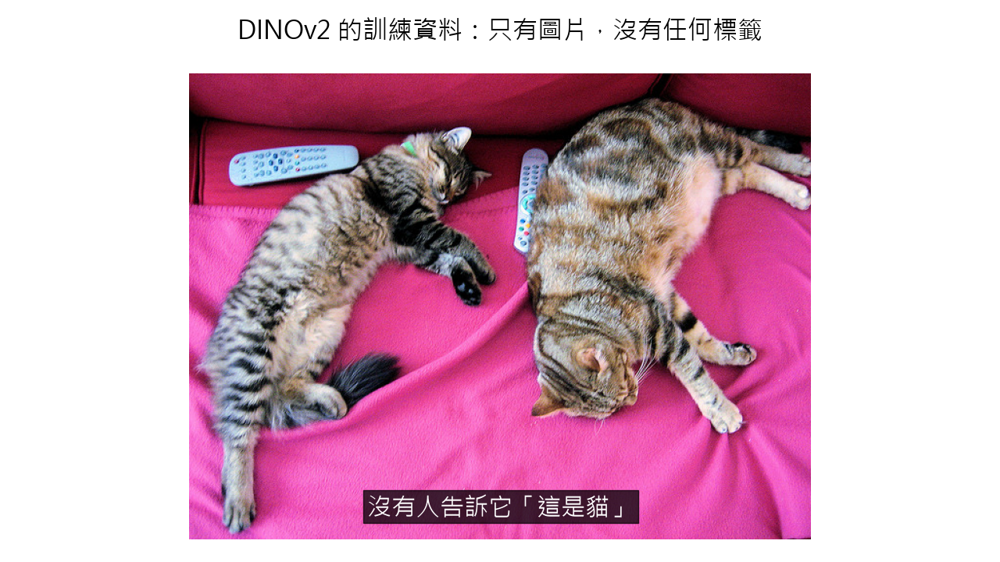
> 架構看完了，接著看它怎麼訓練。DINOv2 的訓練資料只有圖片，大約 1.42 億張。
> 沒有人告訴它「這是貓」。它靠一個老師和學生的遊戲來學。

## 2-2 裁大塊
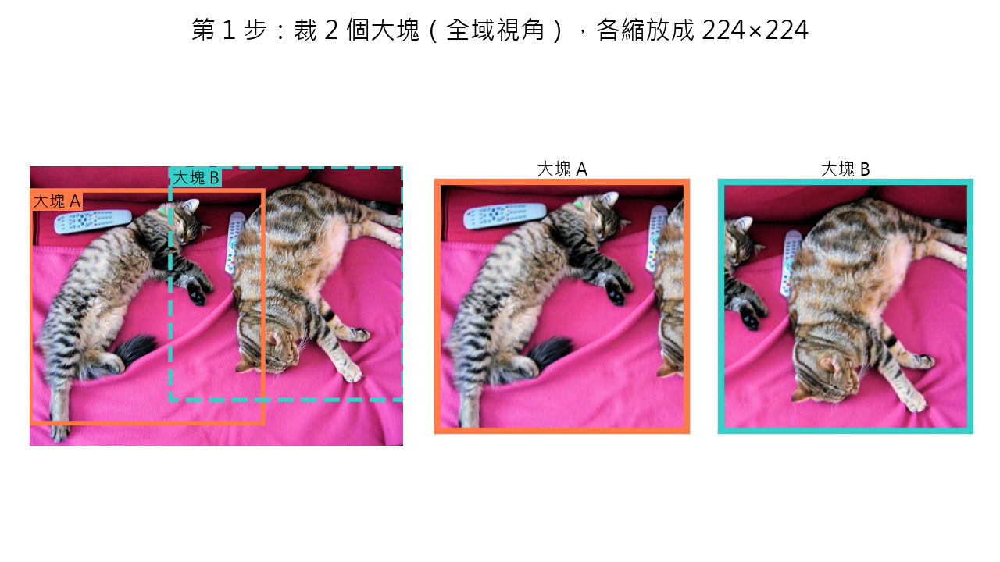
> 第一步，從同一張照片裁出 2 個大塊，叫全域視角。
> 大塊 A 是左半邊，大塊 B 是右半邊，各縮放成 224 乘 224。

## 2-3 裁小塊
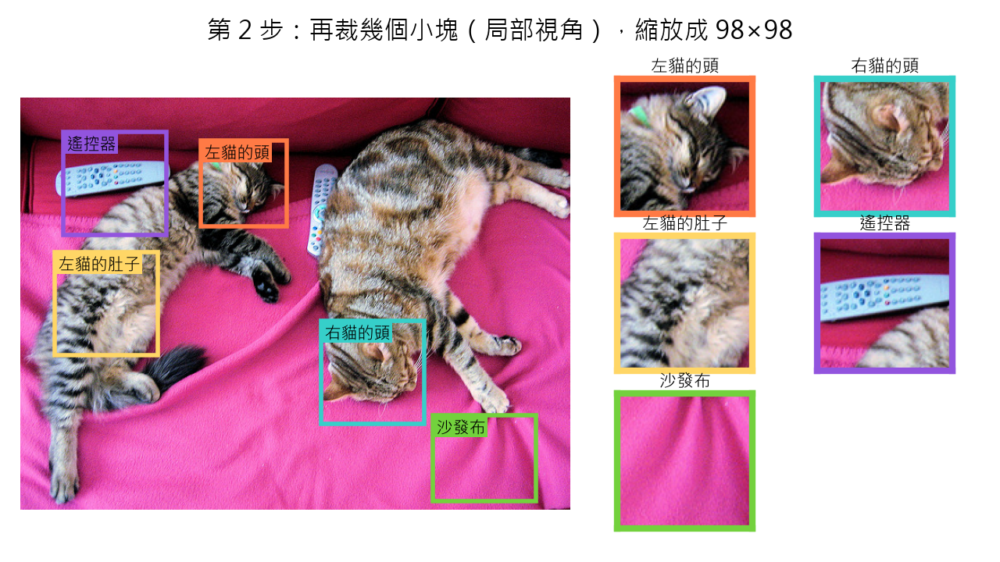
> 第二步，再裁幾個小塊，叫局部視角，縮放成 98 乘 98。
> 這裡示範 5 塊：左貓頭、右貓頭、左貓肚子、遙控器，還有一塊沙發布。

## 2-4 遮住一部分
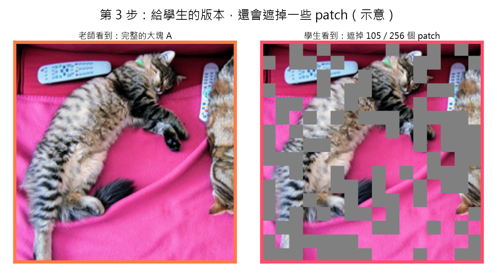
> 第三步，給學生的版本還會故意遮掉一些 patch。
> 老師看到完整的圖，學生只看到被遮過的圖或小塊。

## 2-5 遊戲規則
```flow LR
大塊 A -> 老師網路
小塊或遮過的圖 -> 學生網路
老師網路 -> 老師的答案
學生網路 -> 學生的答案
老師的答案 -> *比對
學生的答案 -> *比對
*比對 -> 學生網路: 調整權重
學生網路 --> 老師網路: 權重慢慢平均過去
```
> 老師和學生是同一個架構，就是剛剛那 12 層。[老師網路]看大塊 A。
> [學生網路]只看小塊，或被遮過的圖。
> 兩邊各自經過 DINO head，輸出一組編號機率。
> 接著拿兩份答案來[比對]。
> 學生的目標是：只看一小塊，也要說出跟老師一樣的答案。
> 不一樣，就調整學生的權重。
> 老師不另外訓練。它的權重是學生過去一段時間的平均，所以比學生穩定。
> 這兩件事一直重複，學生和老師就一起變強。

## 3-1 訓練前
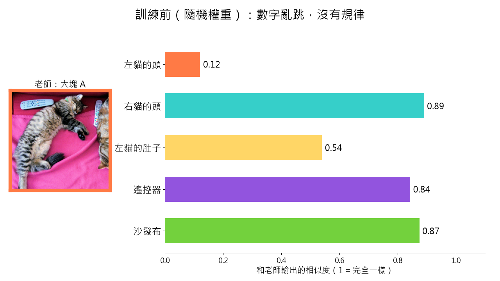
> 我們實際量量看。這是還沒訓練、隨機權重的模型，算每個小塊的 CLS 特徵和大塊 A 有多像。
> 數字亂跳：左貓頭只有 0.12，沙發布反而 0.87。完全沒有意義。

## 3-2 訓練後
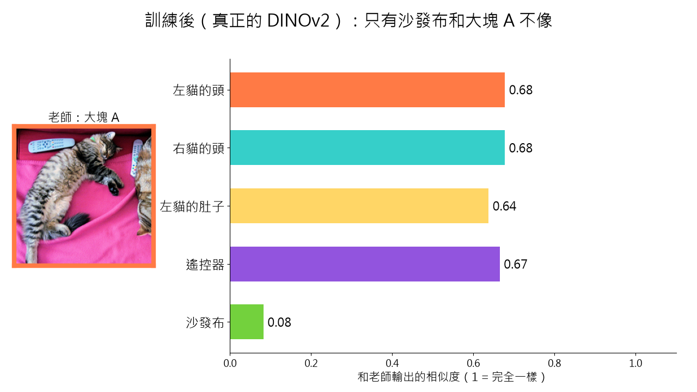
> 換成訓練好的 DINOv2。貓頭、肚子和遙控器都在 0.64 到 0.68 之間。
> 只有沙發布掉到 0.08。大塊 A 的主角是貓和遙控器，背景布料不算。

## 3-3 patch 對 patch：貓
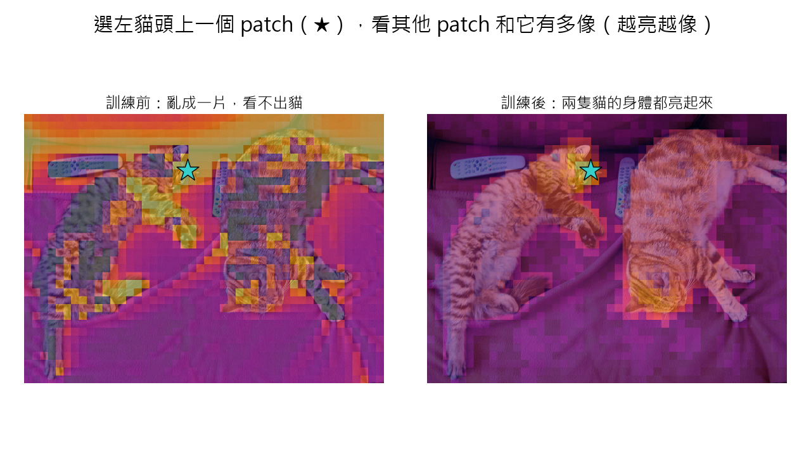
> 再看 patch 特徵。選左貓頭上的一個 patch，看其他 patch 跟它有多像。
> 訓練前亂成一片。訓練後，兩隻貓的身體都亮了。

## 3-4 patch 對 patch：沙發
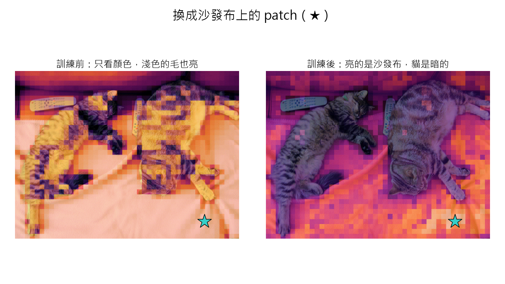
> 換成沙發布上的 patch。訓練前它只看顏色，所以淺色的貓毛也跟著亮。
> 訓練後，亮的是沙發布，兩隻貓都暗下來。它分得出「布」和「貓」。

## 3-5 整張特徵圖
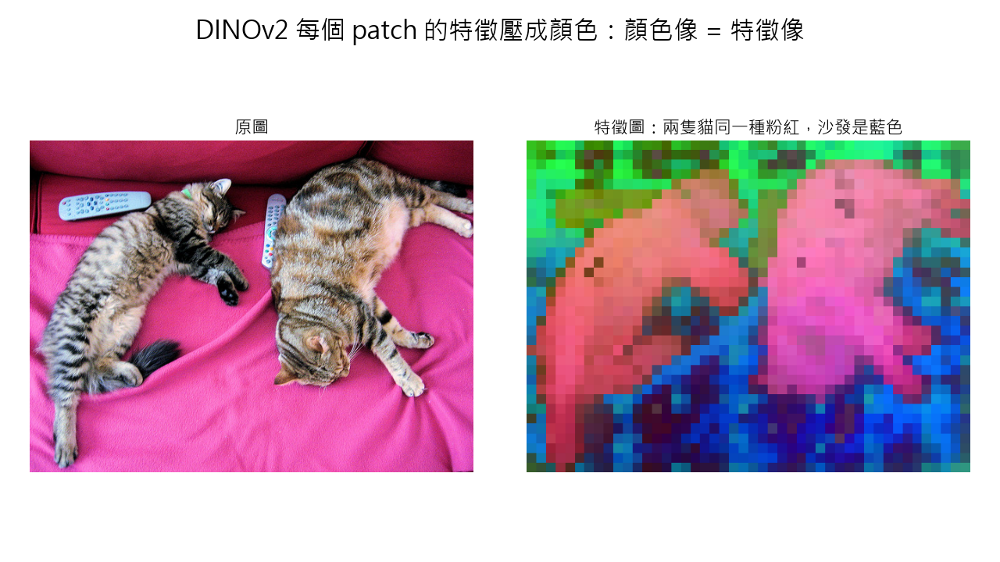
> 最後把每個 patch 的特徵壓成顏色。兩隻貓是同一種粉紅，沙發是藍色。
> 全程沒有任何標籤，它自己學會把同一種東西放在一起。

## 4-1 RF-DETR 裡的 DINOv2
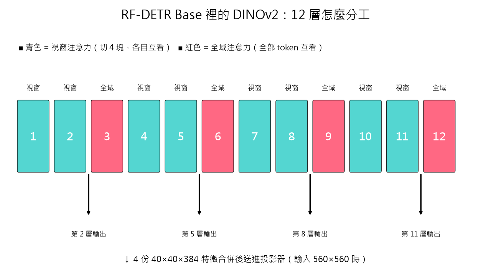
> 最後看 RF-DETR 怎麼用它。它保留同樣的 12 層，但改了注意力的範圍。
> 青色的 8 層用視窗注意力，token 只和同一個視窗的鄰居互看。紅色的第 3、6、9、12 層，才讓全部 token 互看。
> 第 2、5、8、11 層的輸出，會一起送進投影器，給後面的解碼器用。

## 4-2 整條路
```flow LR
1.42 億張無標籤圖片 -> 老師學生遊戲
老師學生遊戲 -> *DINOv2
*DINOv2 -> RF-DETR 骨幹
你的幾百張標註圖 -> RF-DETR 微調
RF-DETR 骨幹 -> RF-DETR 微調
RF-DETR 微調 -> 你的偵測模型
```
> 整條路是這樣。先用大量無標籤圖片玩這個遊戲。
> 訓練出 [DINOv2]。
> RF-DETR 拿它當骨幹，再改成視窗注意力。
> 你只要準備幾百張有標註的圖。
> 拿來微調，模型只需要學「框在哪、是什麼」。
> 看圖的底子早就有了，所以 RF-DETR 很好微調。
